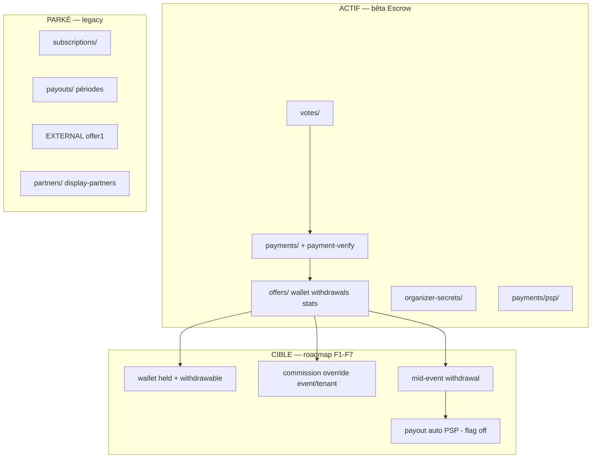

# Cartographie modules — Settlement & finance SHADOMA Votes

**Date :** 2026-08-28  
**Référence :** [`2026-08-28-settlement-business-plan.md`](./2026-08-28-settlement-business-plan.md)  
**Objectif :** Savoir **exactement** où se situe chaque brique — active, cible, parkée ou à supprimer.

---

## Légende des statuts

| Statut | Signification | Action code |
|--------|---------------|-------------|
| **ACTIF** | Utilisé en bêta Escrow aujourd’hui | Maintenir, tests obligatoires |
| **CIBLE** | Spécifié dans le business plan, pas encore livré | À implémenter (F1–F7) |
| **PARKÉ** | Plus dans le parcours produit ; conservé pour reprise ou migration | `legacy/` ou section admin « Hérité » ; pas de nouvelle feature |
| **À SUPPRIMER** | Remplacé ou obsolète ; suppression après gate + période de grâce | Marquer `@deprecated`, puis delete dans PR dédiée |

**Règle d’or :** aucun module PARKÉ ou À SUPPRIMER ne doit apparaître dans le parcours orga bêta (dashboard, onboarding, modales). Admin : section **Hérité** repliée par défaut.

---

## Vue d’ensemble (diagramme)

---

## API — modules NestJS

| Module | Chemin | Statut | Rôle |
|--------|--------|--------|------|
| **Votes** | `apps/api/src/votes/` | ACTIF | Cast vote, pages publiques, gate event |
| **Payments** | `apps/api/src/payments/` | ACTIF | Init payin, webhook, démo, réconciliation |
| **Payment verify** | `payments/payment-verify.service.ts` | ACTIF | **Seul writer** SUCCEEDED + wallet credit |
| **PSP registry** | `payments/psp/` | ACTIF | Credentials plateforme / orga / event |
| **Offers** | `apps/api/src/offers/` | ACTIF / CIBLE | Wallet, retraits, clôture, stats, settings |
| ↳ Wallet | `offers/wallet.service.ts` | ACTIF → CIBLE | `pending`/`available` → `held`/`withdrawable` (F2) |
| ↳ Withdrawals | `offers/withdrawals.service.ts` | ACTIF | Retraits manuels ; auto = CIBLE F6 |
| ↳ Event settlement | `offers/event-settlement.service.ts` | ACTIF → À SUPPRIMER* | Clôture + retenue 5 % — *retirer quand commission/vote + held (F2) |
| ↳ Event stats | `offers/event-stats.service.ts` | ACTIF | CA event orga + admin |
| ↳ Offer settings | `offers/offer-settings.service.ts` | ACTIF / CIBLE | Flags + taux standard + validation override commission (F1) |
| ↳ Organizer offers | `offers/organizer-offers.controller.ts` | ACTIF | `/organizer/wallet`, `/organizer/offer`, close event |
| ↳ Admin offers | `offers/admin-offers.controller.ts` | ACTIF | Retraits admin, events stats |
| **Organizer secrets** | `apps/api/src/organizer-secrets/` | ACTIF | Clés PSP orga/event, `payment-setup/status` |
| **Payout destination** | `payouts/payout-destination.service.ts` | ACTIF | MoMo chiffré retrait ; UI = CIBLE F4 |
| **Payouts (périodes)** | `apps/api/src/payouts/` | PARKÉ | Versements périodiques flow EXTERNAL ; admin legacy |
| **Subscriptions** | `apps/api/src/subscriptions/` | PARKÉ | Abonnements / plans legacy ; le gate vote ne s'applique plus qu'à l'offre EXTERNAL (27/10/2026) |
| **Partners** | `apps/api/src/partners/` | PARKÉ | Programme partenaire |
| **Display partners** | `apps/api/src/display-partners/` | PARKÉ | Carrousel partenaires affichage |
| **Platform control** | `apps/api/src/platform-control/` | ACTIF | Secrets plateforme FeexPay, vault |
| **Tickets** | `apps/api/src/tickets/` | ACTIF | Billetterie : achat par le circuit de paiement des votes, stock verrouillé, recette ESCROW au portefeuille (27/10/2026) |
| **Admin plans** | `apps/api/src/admin/plans/` | PARKÉ | Anciens plans → remplacé par `/admin/offers` |

---

## Web — pages & composants

### Dashboard organisateur

| Route / fichier | Statut | Rôle |
|-----------------|--------|------|
| `/dashboard/wallet` | ACTIF → CIBLE | Portefeuille ; + poches held/withdrawable (F4) |
| `/dashboard/offer` | ACTIF → CIBLE | Offre Escrow ; + affichage taux/override (F7) |
| `/dashboard/events/[id]` | ACTIF | Stats event, clôture, top-up |
| `/dashboard/subscription/*` | PARKÉ | Abonnement legacy — pas dans nav sidebar |
| `/dashboard/page.tsx` | ACTIF | Home ; bannières subscription = PARKÉ si Escrow |
| `components/dashboard-sidebar.tsx` | ACTIF | Nav : wallet, offer (pas subscription) |

### Admin

| Route | Statut | Section sidebar |
|-------|--------|-----------------|
| `/admin/offers` | ACTIF | Offres & argent |
| `/admin/offers/events` | ACTIF | Offres & argent |
| `/admin/offers/withdrawals` | ACTIF | Offres & argent — **file retraits bêta** |
| `/admin/subscriptions` | PARKÉ | Offres & argent (à déplacer → Hérité) |
| `/admin/plans` | PARKÉ | Rediriger ou Hérité |
| `/admin/payouts` | PARKÉ | Hérité |
| `/admin/partners` | PARKÉ | Hérité |
| `/admin/account-partners` | PARKÉ | Hérité |
| `/admin/display-partners` | PARKÉ | Hérité |
| `/admin/payments` | ACTIF / revue | Vue paiements — clarifier vs offers |

### Zone publique (sanctuarisée)

| Route | Statut |
|-------|--------|
| `/e/*` funnel vote | ACTIF — **ne pas casser** |
| `use-public-vote-payment.ts` | ACTIF |

---

## Données — Prisma (finance)

| Modèle / champ | Statut | Note |
|----------------|--------|------|
| `Tenant.offerType` ESCROW | ACTIF | Défaut bêta |
| `Tenant.offerType` EXTERNAL | PARKÉ | `offer1_external_enabled=false` |
| `Tenant.commissionBps` | ACTIF | Négociation orga |
| `Event.commissionBps` | ACTIF | Négociation event |
| `OrganizerWallet.pendingCfa` | ACTIF → CIBLE | Migrer vers held + withdrawable |
| `OrganizerWallet.availableCfa` | ACTIF → CIBLE | → `withdrawableCfa` |
| `WalletLedgerEntry` | ACTIF | Étendre kinds : `HELD_*` (F2) |
| `WithdrawalRequest` | ACTIF | + statut `IN_FLIGHT` pour auto F6 |
| `PaymentTransaction.commissionCfa` | ACTIF | Source de vérité commission |
| `AccountSubscription` | PARKÉ | Legacy abonnement |
| `Payout` / `PayoutPeriod` | PARKÉ | Flow EXTERNAL |
| `PlatformSetting.offer2_retention_bps` | À SUPPRIMER* | Si commission/vote + held actifs |

---

## Flags & configuration

| Clé / env | Statut | Valeur bêta |
|-----------|--------|-------------|
| `offer2_escrow_enabled` | ACTIF | `true` |
| `offer1_external_enabled` | PARKÉ | `false` |
| `offer2_per_vote_commission_enabled` | CIBLE | `true` après F2 |
| `offer2_retention_bps` | À SUPPRIMER* | Désactivé si commission/vote |
| `API_PAYMENT_DEMO_MODE` | ACTIF | dev/staging only |
| `withdrawal_auto_psp_enabled` | CIBLE F6 | `false` prod jusqu’à gate §6.1 BP |

---

## Plan de nettoyage code (ordre)

| Étape | Quoi | Quand |
|-------|------|-------|
| **N1** | Documenter statuts (ce fichier) | Immédiat |
| **N2** | Déplacer `/admin/subscriptions` + `/admin/plans` sous nav Hérité uniquement | Vague admin |
| **N3** | ✅ Fait le 27/10/2026 : gate `AccountSubscription` du vote limité à l'offre EXTERNAL (`votes.service.ts`) | — |
| **N4** | Implémenter held/withdrawable ; stopper retenue clôture 5 % | F2 |
| **N5** | Dossier `apps/api/src/_legacy/` ou tag JSDoc `@legacy` sur modules PARKÉ | Post-F4 |
| **N6** | Supprimer routes dashboard `/subscription` après 1 release sans trafic | Post-bêta |
| **N7** | Supprimer `payouts/` périodes si EXTERNAL jamais réactivé | Décision produit |

**Ne pas supprimer** sans : (1) remplacement livré, (2) e2e vert, (3) note dans CHANGELOG / ADR.

---

## Où ajouter du nouveau code (convention)

| Besoin | Emplacement |
|--------|-------------|
| Logique wallet held / withdrawable | `offers/wallet.service.ts` + migration Prisma |
| Validation floor/ceiling + audit override commission | `offers/offer-settings.service.ts` (pas de nouveau service — réutilise `Event.commissionBps` / `Tenant.commissionBps`) |
| Palier de confiance (compteur events sans incident) | `offers/trust-tier.service.ts` (nouveau, F5) |
| Payout auto retrait | `offers/withdrawal-payout.service.ts` (nouveau, F6) — **pas** dans `payouts/` legacy |
| UI wallet 3 poches | `apps/web/app/dashboard/wallet/page.tsx` |
| UI négociation commission admin | `apps/web/app/admin/offers/events/[eventId]/` |

---

## Références ADR / docs

| Document | Lien |
|----------|------|
| Business plan settlement | `docs/superpowers/specs/2026-08-28-settlement-business-plan.md` |
| Offres EXTERNAL/ESCROW | `docs/adr/ADR-019-settlement-offers.md` |
| Verify-by-pull | `docs/adr/ADR-017-payments-verify-by-pull.md` |
| Démo paiements | `docs/guide-lancement-paiements-demo.md` |
| ADR-020 | [`docs/adr/ADR-020-settlement-finance-model.md`](../../adr/ADR-020-settlement-finance-model.md) — proposé, en attente revue produit |

---

*Dernière mise à jour : 2026-08-28 — maintenir ce fichier à chaque PR touchant finance / offers / payouts / subscriptions.*
